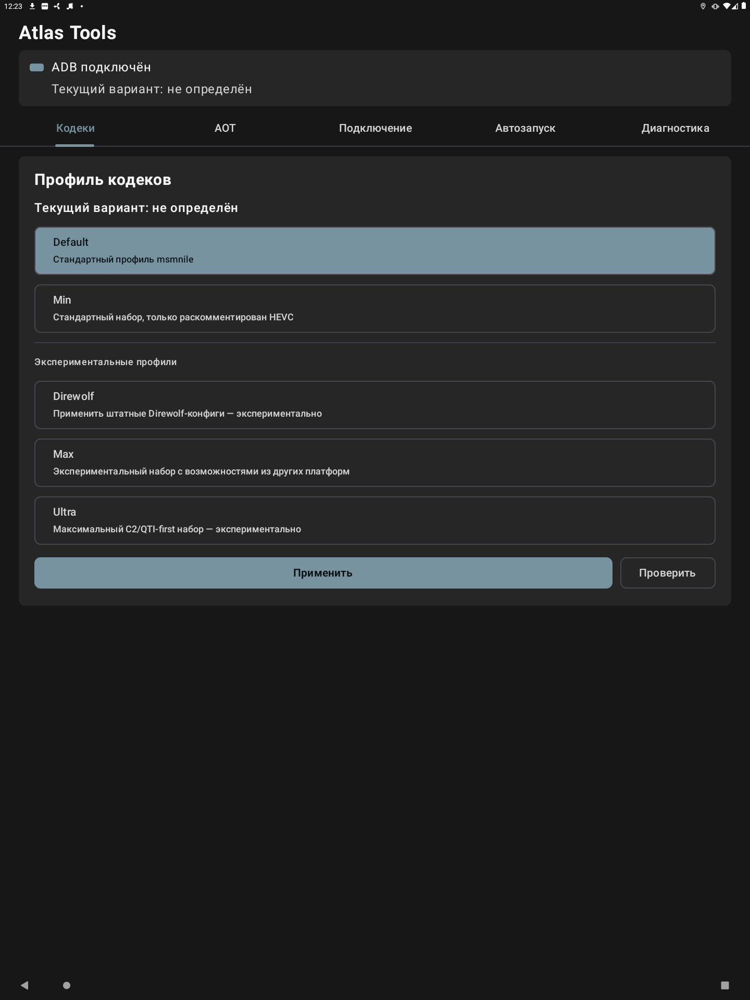

<p align="center">
  
</p>

<h1 align="center">Atlas Tools</h1>

<p align="center">
  Служебные инструменты для Android-головных устройств Atlas с root-доступом
</p>

Atlas Tools (бывший Atlas Codec Fix) подключается к локальному `adbd` и объединяет два
инструмента:

- **Codec Fix** — проверяет совместимость устройства и через `su root` временно перекрывает
  выбранные файлы конфигурации в `/vendor/etc` точечными bind mount. Предназначен прежде всего для
  устройств на платформе Qualcomm `msmnile` с ожидаемым набором vendor-файлов;
- **AOT-компиляция** — компилирует приложения Atlas и сопутствующие приложения с профилем ART
  `speed` и при необходимости повторяет компиляцию после загрузки.

Идентификатор пакета остался прежним (`com.mmwtl.atlascodecfix`), поэтому новая версия
устанавливается поверх старой с сохранением настроек, ADB-ключа и включённой спецвозможности.

> Приложение выполняет команды с root-правами. Неподходящая конфигурация может нарушить работу
> видео, звука или камеры до возврата профиля `Default` либо перезагрузки устройства.

## Интерфейс

Сверху закреплена шапка с состоянием ADB и результатом последней операции: индикатор занятости,
успех или текст ошибки видны с любой вкладки, длинный отчёт раскрывается кнопкой «Подробнее».
Ниже расположены вкладки:

- «Кодеки» — активный и выбранный профили, основная кнопка «Применить» и вторичная «Проверить».
  Экспериментальные варианты отделены от основных. Если ADB helper выключен или не подключён,
  над кнопками появляется строка с переходом на вкладку «Подключение»;
- «AOT» — состояние компиляции каждого приложения из списка, кнопка «Скомпилировать все» для
  приложений без профиля `speed`, принудительная перекомпиляция отдельного приложения и
  «Проверить»;
- «Подключение» — ADB helper, режим Atlas/Preface/Custom/Telnet, адрес, порт, подключение и
  отключение;
- «Автозапуск» — автоприменение codecfix и AOT-проверка после загрузки, задержка, резервный запуск через специальные
  возможности и уведомления об ошибках;
- «Диагностика» — preflight, диагностический отчёт, выгрузка файлов для анализа, список кодеков
  и отдельная карточка «Опасная зона» с `Небезопасным режимом`.

<p align="center">
  <a href="docs/images/main-screen.png">
    
  </a>
</p>

Встроенный просмотрщик на вкладке «Диагностика» выводит обнаруженные Android-кодеки и позволяет
отфильтровать их по аппаратной или программной реализации и типу медиа; фильтры свёрнуты, пока
не нужны.

<p align="center">
  <a href="docs/images/codecs-screen.png">
    
  </a>
</p>

## Возможности

- подключение к ADB по настраиваемым адресу и TCP-порту; доступны режимы Atlas (`5555`),
  Preface (`7777`) и Custom;
- совместимый с GInputBridge Telnet-режим с автоматическим обнаружением локального shell,
  приоритетной проверкой последнего рабочего порта и ограниченным ожиданием позднего запуска
  shell после загрузки; при закрытом прошивкой `/proc/net/tcp*` порт можно указать вручную;
- сохранение ADB-ключа в приватном no-backup хранилище приложения;
- отдельные preflight-проверка и диагностика устройства без изменения конфигурации;
- выгрузка текущих codec-конфигов из стандартных `/vendor/etc`, `/product/etc` и `/system/etc`
  вместе с отдельным `params.txt` в `Downloads/ACF/<timestamp>/`;
- ручное применение профиля с подтверждением риска для экспериментальных вариантов;
- проверка каждого bind mount и автоматический возврат к штатной конфигурации при ошибке или
  несовпадении определённого профиля;
- безопасная операция `Default`, которая не зависит от preflight и файлов других профилей;
- отложенное автоприменение после загрузки Android с ограниченным числом повторов;
- опциональный минимальный AccessibilityService как дополнительный системный триггер после
  загрузки, перезапуска процесса и длительного сна; сервис не читает содержимое окон и не
  выполняет жесты;
- просмотр доступных Android-кодеков с фильтрами по типу, назначению и аппаратному ускорению;
- опциональные уведомления об ошибках ADB, preflight и применения.

## Профили

| Профиль | Назначение | Статус |
| --- | --- | --- |
| `Default` | Снимает активные bind mount и возвращает штатную конфигурацию `msmnile`. | Восстановление |
| `Min` | Подменяет только `media_codecs_msmnile.xml` вариантом с активными объявлениями кодеков C2/QTI HEVC. | Основной |
| `Direwolf` | Накладывает присутствующие на устройстве штатные Direwolf-конфиги на цели `msmnile`. | Экспериментальный |
| `Max` | Применяет агрегированный набор codec, performance, media profile и video specs из нескольких платформ. | Экспериментальный |
| `Ultra` | Применяет агрегированный C2/QTI-first набор codec, performance, media profile и video specs. | Экспериментальный |

Для ручного применения экспериментального профиля приложение запрашивает явное
подтверждение, если не включён `Небезопасный режим`. Его автоприменение доступно только при
включённом `Небезопасном режиме`, который также отключает preflight-защиту и подтверждение риска
как при ручном, так и при автоматическом применении.

## Требования и совместимость

- Android 8.0 или новее (API 26+);
- root-доступ с рабочей командой `su root`;
- локальный демон ADB, доступный по TCP, обычно на `localhost:5555` или `localhost:7777`;
- для Telnet-режима — локальный telnet shell, который приложение обнаруживает среди локальных
  listening-портов;
- подтверждение ADB-ключа приложения при первом подключении, если его запрашивает устройство;
- для подтверждённого preflight — платформа `msmnile`, объявление кодека Qualcomm HEVC и файлы:
  - `/vendor/etc/media_codecs_msmnile.xml`;
  - `/vendor/etc/media_codecs_performance_msmnile.xml`;
  - `/vendor/etc/media_profiles_msmnile.xml`;
  - `/vendor/etc/video_system_specs.json`;
  - `/vendor/etc/media_msmnile/video_system_specs.json`.

Если необходимые файлы или объявление кодека HEVC отсутствуют, preflight помечает устройство как
неподдерживаемое. Другая платформа при наличии всех файлов получает статус `risky`: ручное
применение можно подтвердить явно, но безопасное автоприменение не разрешается.

Прошивки автомобильных ГУ различаются составом vendor-конфигурации, реализацией `su`, политиками
SELinux и поведением медиасервисов. Поэтому совместимость с конкретной моделью и версией прошивки
нужно проверять на реальном устройстве. Профили `Direwolf`, `Max` и `Ultra` намеренно считаются
экспериментальными.

## Установка и применение

1. Установите подписанный APK Atlas Tools на головное устройство.
2. Убедитесь, что локальный `adbd` принимает TCP-подключения и устройству доступен `su root`.
3. Откройте приложение и включите `ADB helper`.
4. Выберите режим подключения: `Atlas`, `Preface`, `Custom` или `Telnet`; для первых трёх
   укажите адрес и порт, затем нажмите `Подключить`.
5. Запустите `preflight` или откройте `Диагностика`, не изменяющую конфигурацию. Для выгрузки
   данных нажмите `Выгрузить файлы для анализа`: в `Downloads/ACF/<timestamp>/default/` будут
   сохранены найденные codec XML/JSON-файлы, а параметры и настройки — в `params.txt`.
6. Выберите профиль и нажмите `Применить`. Для экспериментального профиля подтвердите риск.
7. Нажмите `Проверить`, чтобы заново определить активный профиль, и при необходимости откройте
   список доступных кодеков.
8. Для повторного применения после перезагрузки включите `Codecfix после загрузки` и задайте
   задержку от 0 до 3600 секунд.
9. Для ГУ, которые нестабильно доставляют `BOOT_COMPLETED` или останавливают фоновые задачи,
   включите сервис `Надёжный автозапуск Atlas Tools` в системном разделе специальных возможностей.
   Это дополнительный триггер; обычный boot receiver и `JobScheduler` продолжают работать без него.

Bind mount существуют только до перезагрузки. Чтобы вернуть штатное состояние без перезагрузки,
примените `Default`. Медиасервисы перезапускаются только после проверки полного набора mount'ов или
после явного восстановления.

## AOT-компиляция

Вкладка «AOT» работает с фиксированным списком пакетов:

| Приложение | Пакет |
| --- | --- |
| Atlas Launcher | `com.geely.atlaslauncher` |
| Atlas App Widget | `com.mmwtl.atlasappwidget` |
| Atlas App Window | `com.mmwtl.atlasappwindow` |
| Atlas Climate Widget | `com.mmwtl.atlasclimatewidget` |
| Atlas Media Widget | `com.mmwtl.atlasmediawidget` |
| Atlas Media API | `com.mmwtl.atlasmediaapi` |
| Atlas Dim | `com.mmwtl.atlasdim` |
| Atlas Terminal | `com.mmwtl.atlasterminal` |
| GInputBridge (GIB) | `com.salat.gbinder` |
| GSplit | `com.salat.gsplit` |
| Open Headunit | `com.andrerinas.headunitrevived` |
| Open Headunit Geely | `com.andrerinas.headunitrevived.geely` |
| GMediaProxy (GMP) | `com.geely.online.service` |
| GMediaHud (GMH) | `com.salat.gmediahud` |
| Atlas Tools | `com.mmwtl.atlascodecfix` |

Atlas Tools стоит в списке последним: при пакетной компиляции он обрабатывается после всех
остальных приложений. Компиляция не останавливает запущенный процесс, новый код используется со
следующего запуска.

Состояние читается одним вызовом `dumpsys package dexopt` (Android 11 игнорирует имя пакета и
всегда выводит все пакеты): приложение считается скомпилированным, когда все основные dex-файлы
имеют фильтр `speed` (или `everything`). Debuggable-сборки ART в `speed` не компилирует: такие
приложения помечаются как «Debug-сборка», не компилируются ни вручную, ни после загрузки и не
вызывают уведомлений об ошибке. Флаг debuggable читается через `PackageManager`, поэтому пакеты
списка перечислены в `<queries>` манифеста. Компиляция выполняется
командой `cmd package compile -m speed -f <пакет>` через тот же ADB-канал; root и изменения в
`/vendor` для неё не нужны. Успех засчитывается только при нулевом коде выхода и подтверждённом
фильтре `speed` при повторной проверке. Операции AOT и Codec Fix используют общую блокировку и не
выполняются одновременно.

Профиль `speed` занимает заметно больше места, чем штатный `speed-profile`. Обновление приложения
или прошивки, а также фоновая оптимизация системы сбрасывают фильтр. Переключатель
`AOT после загрузки` при каждой загрузке проверяет список и перекомпилирует только приложения,
потерявшие `speed`.

## Как выполняется применение

1. Приложение подготавливает root-скрипты и, если нужны, встроенные файлы выбранного профиля во
   временном каталоге.
2. Через ADB выполняется цепочка `su root sh -c`.
3. Для профиля, отличного от `Default`, запускается preflight, если пользователь явно не отключил
   его в небезопасном режиме.
4. Подготовленный каталог атомарно размещается в `/dev/hevc`. Для `Min`, `Max` и `Ultra`
   накладываются только файлы, перечисленные в `profile.manifest`; `Direwolf` использует отдельный
   фиксированный набор штатных vendor-файлов устройства.
5. Каждый mount проверяется по таблице mount'ов и содержимому файла.
6. Итоговый профиль определяется повторно. Любая ошибка или несовпадение запускает откат к
   штатному состоянию.

## Сборка и проверка

Требуются JDK 17 и Android SDK 36. Используйте Gradle Wrapper из репозитория:

```sh
ANDROID_HOME=/path/to/android-sdk sh gradlew verify :app:assembleDebug
```

Задача `verify` запускает JVM unit tests, Android lint, тест root-транзакции с имитацией mount и
проверку XML, JSONC, манифестов и инвариантов профилей. Debug APK создаётся в
`app/build/outputs/apk/debug/`.

Для release-сборки скопируйте пример `app/_secure.signing.gradle` в игнорируемый Git файл
`secure.signing.gradle`, заполните параметры ключа и выполните:

```sh
ANDROID_HOME=/path/to/android-sdk sh gradlew :app:assembleRelease
```

Без настроенной приватной подписи сборка release-варианта завершается ошибкой; проект не
подменяет release-ключ стандартным debug-ключом. Итоговый APK создаётся в
`app/build/outputs/apk/release/` с именем вида
`<versionName>[<versionCode>]AtlasTools-release.apk`.

### Проверка на эмуляторе

adbd эмулятора не открывает TCP-порт внутри Android, поэтому режим ADB на эмуляторе не
проверить. Для режима Telnet скрипт поднимает root-shell, доступный только на `127.0.0.1`
внутри эмулятора (нужен образ с `adb root`, например userdebug):

```sh
scripts/emulator-telnet-shell.sh start    # [port], по умолчанию 2323
scripts/emulator-telnet-shell.sh status
scripts/emulator-telnet-shell.sh stop
```

В приложении выберите `Telnet`, адрес `localhost` и выведенный порт. Скрипт отказывается работать
с устройством, которое не является эмулятором. Слушатель и `adb root` сбрасываются при
перезагрузке эмулятора.

Проверьте подпись собранного release APK:

```sh
apksigner verify --verbose --print-certs app/build/outputs/apk/release/*.apk
```

## Документация и исходные конфигурации

- [`hevc/preflight.sh`](hevc/preflight.sh) — проверка root, vendor-файлов, объявления HEVC и
  платформы;
- [`hevc/codecfix.sh`](hevc/codecfix.sh) — restore/apply-транзакция, проверка mount и откат;
- [`hevc/detect.sh`](hevc/detect.sh) — определение активного профиля;
- [`NOTICE.md`](NOTICE.md) — условия и уведомления для включённых Qualcomm/vendor-конфигураций.

Проект пока не предоставляет общую open-source лицензию. Перед распространением APK или
vendor-конфигураций ознакомьтесь с [`NOTICE.md`](NOTICE.md).
